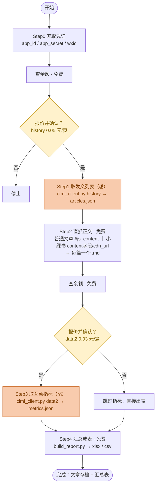

# gzh-research · 微信公众号全量采集与存档

把一个公众号的全部历史文章抓下来、存成 Markdown，并汇总成带「内容分类 / 类型 / 阅读·点赞·在看·评论·分享」的 Excel/CSV 表格。

- 发文列表、互动指标：走**次幂数据(cimidata)付费 API**（按次计费，调用前会先报价并征得同意）。
- 文章正文：**免登录直抓 mp.weixin.qq.com**（免费），并正确区分「普通图文文章」与「小绿书/图片消息」两种页面结构。

---

## 一、准备（3 样东西）

1. **app_id / app_secret**（次幂付费凭证）
   - 注册：https://www.cimidata.com 注册并登录
   - 开通：https://www.cimidata.com/api-service 开通 API 服务，并在同页面创建 app_id 和密钥
   - 按次计费，页面有价目表和余额
2. **wxid**（目标公众号原始ID，`gh_` 开头）
   - 方法1：https://www.cimidata.com/tools/wxid 直接查
   - 方法2：浏览器打开该公众号任意文章 → `Ctrl+U` 看源码 → 搜 `var user_name`，`gh_` 开头即为 wxid
3. **运行环境**：Python 3，安装依赖
   ```bash
   pip install requests beautifulsoup4 lxml openpyxl
   ```

> 凭证只通过环境变量传入，**切勿写进代码或提交到 git**。

---

## 二、关于花钱（重要）

次幂接口按次计费。**每一步要花钱前，都会先告诉你**：调用哪个接口、单价、总价、当前余额够不够，**你同意后才执行**；执行中若可能超预算，会停下来再问你。主要参考单价（以官网实时价目表为准）：

| 接口 | 用途 | 参考单价 |
|---|---|---|
| 查余额 | 调用前先查 | 免费 |
| 历史发文列表 | 取全部文章（约10篇/页） | 0.05 元/页 |
| 互动指标 data2 | 阅读+点赞+在看+评论+分享 | 0.03 元/篇 |
| 搜公众号 | 只有名称时用它拿 wxid | 0.10 元/次 |

---

## 三、四步跑完

```bash
export APP_ID="你的app_id"
export APP_SECRET="你的app_secret"

# 步骤1  取全部历史发文（计费）→ articles.json
python scripts/cimi_client.py history gh_xxxx articles.json

# 步骤2  免登录直抓正文（免费）→ 输出目录（每篇一个 .md）
python scripts/scrape_content.py articles.json ./文章存档 --sleep 1.0

# 步骤3  取互动指标（计费）→ metrics.json
python scripts/cimi_client.py data2 articles.json metrics.json

# 步骤4  汇总成表 → 文章汇总表.xlsx / .csv
python scripts/build_report.py articles.json ./文章存档 metrics.json -o 文章汇总表
```

只想存正文不买指标，就跑步骤 1+2+4（步骤4 的 metrics.json 省略即可，指标列显示“—”）。

---

## 四、脚本说明

| 脚本 | 作用 | 关键点 |
|---|---|---|
| `scripts/cimi_client.py` | 次幂 API：token / 历史列表 / 指标 / 余额 | 自动翻页、断点续传、限速、失败不计费自动重试、余额不足即停 |
| `scripts/scrape_content.py` | 直抓正文转 Markdown | **三种结构**：普通图文(`#js_content`) / 文字型小绿书(JS `content` 字段) / 纯图片小绿书(`cdn_url` 图片序列)；标题去重；≥1s/篇限速防风控 |
| `scripts/build_report.py` | 组装汇总表 | 多标签内容分类、序号前缀匹配已存文件、指标列、Excel 着色与筛选 |

详细踩坑与接口速查见 `references/pitfalls.md`、`references/cimi_quickref.md`。

---

## 五、常见问题

- **一类文章“正文为空”？** 多半是小绿书。普通文章正文在 `#js_content`，小绿书没有这个节点，脚本已按 `content` 字段 / `cdn_url` 兜底，正常情况下不会空。
- **抓一批后开始拿不到正文？** 触发了微信风控（返回验证页），暂停一段时间再跑即可自愈；脚本有断点续传，不会重复抓。
- **末尾几篇没有指标？** 余额差一点导致，充值后重跑 `data2`（自动跳过已取的）即可补齐。
- **指标列对不上？** 注意 `old_like_num` 才是点赞、`like_num` 是在看，脚本已按正确列映射。

---

## 六、执行流程图（含付费闸门）

> 只有两步花钱（Step1 取列表、Step3 取指标），且都强制「先查余额 → 报价 → 用户确认 → 才执行」；执行中超预算立即停并再确认。



一句话记忆：**AI 当管家**（管流程、管确认、管钱），**脚本当工人**（`cimi_client.py` 取数、`scrape_content.py` 抓正文、`build_report.py` 出表）。想只存正文不买指标，就跑 Step1+2+4。
